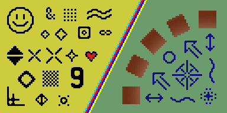
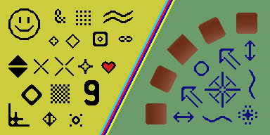

# Scale2xSFX and Scale3xSFX — SLANG render comparisons

Captured on 2026-10-22 from the current upstream shaders and the proposed fixes.
The original 128×64 `Test.png` is included. Before and after use the same settings.

| Shader | Before | After | Changed pixels |
| --- | --- | --- | ---: |
| Scale2xSFX |  |  | 273 |
| Scale3xSFX |  |  | 1,875 |

## Capture settings

RetroArch 1.22.2 on Windows, `glcore`, Intel Graphics. The native Cg reference uses RetroArch 1.9.0 with `gl`.
Each controlled capture runs eight frames with nearest sampling, clamp-to-edge and one shader pass. Final size is 256×128 for Scale2xSFX and 384×192 for Scale3xSFX.
Default YTR/UTR/VTR values are 48/7/6. The parameter probe sets all three to 255 in both before and after.
The separate `upstream-preset.png` capture checks the actual preset, including its presentation pass.

For an independent RetroArch run, load Test.png with the image viewer and use a preset like this (substitute the shader path and scale):

```ini
shaders = 1
shader0 = /path/to/slang-shaders/edge-smoothing/scalenx/shaders/scale2xSFX.slang
filter_linear0 = false
wrap_mode0 = clamp_to_edge
scale_type0 = source
scale0 = 2.0
```

Set the viewport to the corresponding integer multiple. For the parameter probe, save YTR, UTR and VTR as 255.

## Validation

The JSON beside each comparison records source commits/hashes, runtime identity and exact full-frame RGBA metrics. No cropping, alignment or tolerance is applied.
Corrected Slang matches the Cg reference throughout the interior. At defaults there is one border-pixel difference for Scale2xSFX and three for Scale3xSFX, consistent with the existing legacy-GL / GLCore texture-boundary behavior. With thresholds 255, both match Cg exactly.
These results cover this test image and recorded GPU/runtime, rather than every possible input or driver.

This branch holds review evidence. The shader fixes are independent one-commit branches, each based directly on upstream master. Image files here are unmodified native captures.
